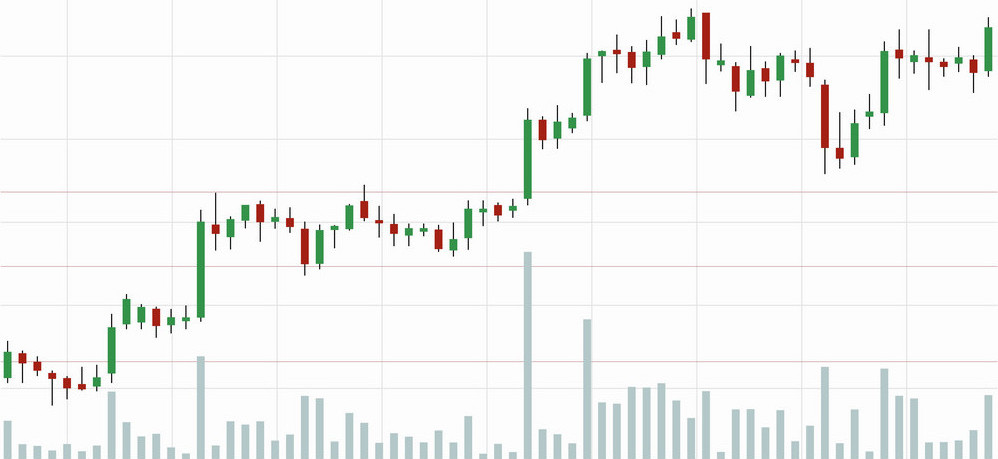
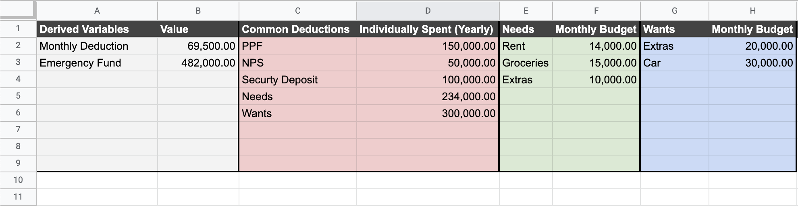
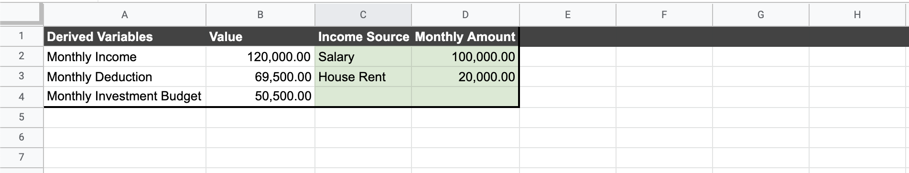
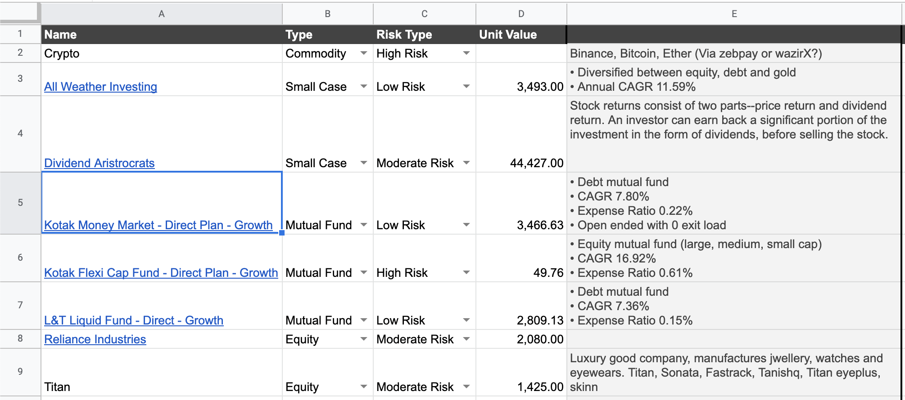
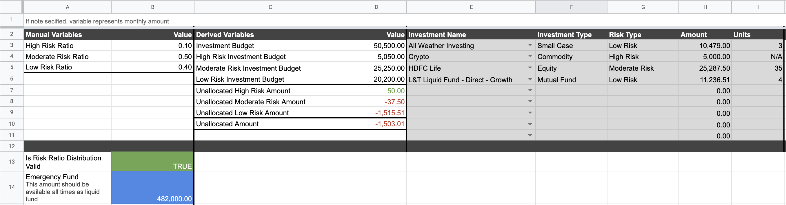

[Financial independence](https://en.wikipedia.org/wiki/Financial_independence#:~:text=Financial%20independence%20is%20the%20status,referred%20to%20as%20passive%20income.) is a subject which is gaining lot of attention. I've been reading on the various aspects ex. what are the options for me to invest, how to diversify portfolio, look at trends and balancesheets, recognize patterns and the [psychology of human misjudgement](https://www.youtube.com/watch?v=pqzcCfUglws&ab_channel=BuffettMungerWisdom). In my humble opinion, everyone should sort their finances as early as possible and become financially independent with the power of [compounding](https://www.investopedia.com/terms/c/compounding.asp#:~:text=Compounding%20is%20the%20process%20whereby,called%20%22miracle%20of%20compounding.%22).

Being in a profession which demands majority of my time, it didn't look feasible for me to be an aggresive investor. So I started thinking on how to strategize my long term investing game. It was clear to me that I need to be disciplined with the investments and have right portfolio diversification. Discipline helps you to take benefit of [dollar cost averaging](https://www.investopedia.com/terms/d/dollarcostaveraging.asp), whereas right diversification provides you with [hedge](https://www.investopedia.com/terms/h/hedge.asp) and helps you to maximize your gains as you recognize trends and maintain risk ratio accordingly.

I chose to use and configure google sheet for managing my investments. You can find the template that I designed for myself [here](https://docs.google.com/spreadsheets/d/1L8FKH-a6_kZPzypsgofT6MsRa5JtArf7rmGRqlFskW4).

**Note**: This post is about my approach and not about what is the best way to manage your finances or plan your budget. Please do your own research using different credible sources. Also the numbers used are placeholders and not real.

## Budget Planning
I needed to figure out a way to have an easy mechanism to get an estimate on approx lumsum amount I can invest monthly. For this I needed to sort my budget. I started with making list of how much I have to spend on **needs** or necessasities like food, rent, securities etc and then **wants** like netflix, phone, car, hangout expense etc.

I created a [sheet](https://docs.google.com/spreadsheets/d/1L8FKH-a6_kZPzypsgofT6MsRa5JtArf7rmGRqlFskW4/edit#gid=1986981816) where I logged all these details and then used these values and basic excel functions to get difference between cash inflow and outflow. Difference is what I had available to invest.

Derived variables are calculated automatically based on values under expenses and incomes.

## Portolio Diversification
I created a [separate sheet](https://docs.google.com/spreadsheets/d/1L8FKH-a6_kZPzypsgofT6MsRa5JtArf7rmGRqlFskW4/edit#gid=1344074706) and started categorizing investment options that I found interesting according to the risk and votality, under **High**, **Moderate** and **Low Risk** investments. Each investment option also had a type for example, equity, commodity, smallcase, mutualfund, bonds etc.

High risk options are speculative and may or may not give return on principle invested amount, moderate are volatile options but should have give good return in longer run, whereas low risk options are less volatile and generally have very low profit margin.

## Systematic Investment Planning
With available amount that needs to be invested monthly and shortlisted investment options, I look at how the Risk Ratio should be structured, depending on how bullish and bearish the market is. So it essentially boils down to:

> ‘Be fearful when others are greedy. Be greedy when others are fearful.’\
> — Warren Buffett

I increase investment in high risk options when I notice if market is undervalued and decrease it otherwise. So in the [sheet](https://docs.google.com/spreadsheets/d/1L8FKH-a6_kZPzypsgofT6MsRa5JtArf7rmGRqlFskW4/edit#gid=0) I have created risk variables which I update according to ongoing market situation, it then tells me how much I have available to invest in the risk categories individually and how much I already have invested.

The shortlisted investment options are fetched from the sheet that we have discussed above.

Then its simple I quickly look at the shortlisted investment options under each category and choose one that I am comfortable with the most. Every month on particular day carry out these investments. This helps me to quickly identify if my investments needs rebalancing and keep them on track.
